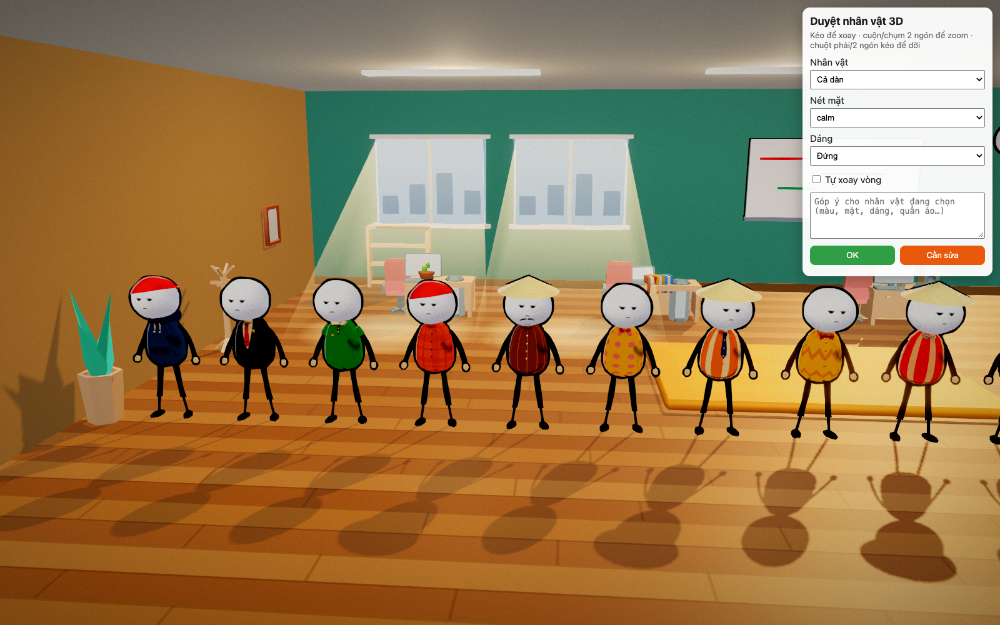
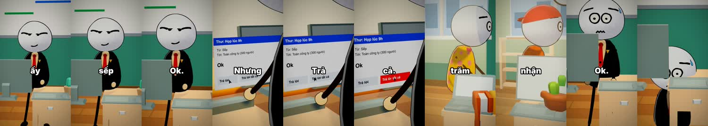
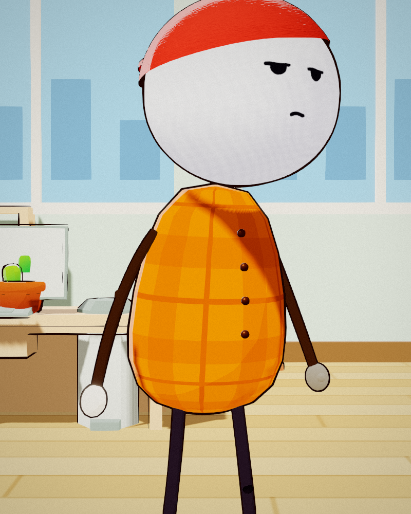

# Claude 3D Animated Shorts

A Claude skill for vertical animated story Shorts with **real 3D characters**, built with three.js and rendered frame by frame on your own machine. No AI video generator is involved.

It started as a copy of [mromidev/claude-animated-shorts](https://github.com/mromidev/claude-animated-shorts) (MIT). That skill uses 2D billboard characters in a 3D world. This one keeps the workflow and moves everything to 3D: every character is a rigged 3D model you can orbit around, pose and animate.

The look and the story formula follow the **RicksClips** YouTube channel ([@RicksClips3000](https://www.youtube.com/@RicksClips3000/shorts)). That means white-headed cartoon people with deadpan faces, a lit 3D world in a darker, warmer, cinematic key, word-by-word captions, and the "odd act → mockery → disaster → science + analogy → loop" script. This project is not affiliated with RicksClips. Only the style is studied. No frames or content from the channel are included.



| | |
|---|---|
|  |  |

## What's inside
| Path | What it is |
|---|---|
| `SKILL.md` | The skill: pipeline, character rules, look values, QA |
| `engine/stickrig.js` | Character builder on a Mixamo rig. Includes white flat-shaded heads with a brush outline in screen pixels, pear/bean bodies, outfits (hoodie, vest, polo, tunic), fabric patterns, ties and bow ties, hats, noodle limbs, mitten hands, IK and drawn faces |
| `engine/main.js` | Scenes: the rail film, the office/home review page (`?viewer=1`), a 10 s office skit (`?viewer=1&skit=1`) and a Wild West chase test (`?chase=1&dur=10`) |
| `engine/world.js`, `engine/post.js` | World and train builder; post chain with ACES grade, bloom, DOF, SMAA and n8ao ambient occlusion |
| `engine/assets/props/` | Kenney Furniture Kit and KayKit Furniture Bits (both CC0), used for the office and home sets |
| `tools/` | ElevenLabs voice with word timings, tempo fit, word-by-word captions, contact sheets |
| `upstream-2d/` | The original 2D skill, audio and scripts from mromidev (MIT), for reference |

## Install
```bash
git clone https://github.com/thuann-vn/claude-3d-animated-shorts ~/.claude/skills/claude-3d-animated-shorts
cd ~/.claude/skills/claude-3d-animated-shorts
bash scripts/fetch-assets.sh          # Xbot rig, horse, fonts (not redistributed here)
cd engine && npm install
```
You need Node 18+, Python 3 with Pillow, ffmpeg, and Chrome or Chromium. If render.cjs can't find the browser, set `CHROME=/path/to/chrome`.

## Try it
```bash
cd engine
npx http-server -p 5310 -c-1 .
# open http://localhost:5310/viewer.html               → orbit/zoom the cast in the office
#      http://localhost:5310/viewer.html?set=home      (append to the redirected URL) → living room + kitchen
XQ="&viewer=1&skit=1" node render.cjs out/skit.mp4 1080 1920 30   # the 10 s office skit
```
Then in Claude Code say: *"Use the 3D animated shorts skill and make a 40 s short about …"*.

## Credits
- Workflow and audio tools: [mromidev/claude-animated-shorts](https://github.com/mromidev/claude-animated-shorts) (MIT)
- Style reference: the RicksClips YouTube channel (style only, not affiliated)
- Furniture: [Poly Haven](https://polyhaven.com) scans (CC0, fetched by the script), [Kenney](https://kenney.nl) Furniture Kit and [KayKit](https://kaylousberg.itch.io/furniture-bits) Furniture Bits (CC0)
- Rig: Xbot from the three.js examples (Mixamo). Horse from the three.js examples. Both are downloaded by the fetch script, not included here.

## Support

If this skill saved you some time, you can [buy me a coffee](https://buymeacoffee.com/thua9678) ☕

## License
MIT for the code and docs (see `LICENSE`). Third-party assets keep their own licenses.
